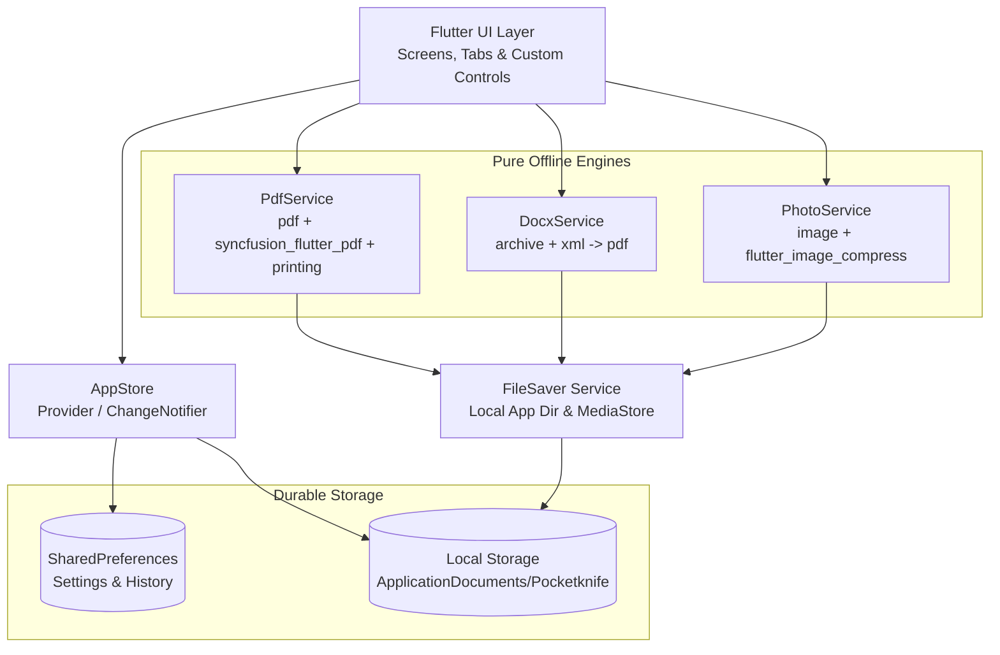

# POCKETKNIFE — PROJECT CONTEXT & MASTER OVERVIEW

> **Primary Entry Point for AI Coding Sessions & Developers**  
> *Last Verified:* October 2026 | *Status:* Production Ready | *Architecture:* 100% Offline Multi-Tool

---

## 1. What Pocketknife Does

**Pocketknife** is a fast, privacy-first, 100% offline utility toolkit for Android built with Flutter. It provides everyday document and media tools that execute entirely in-memory and on-device without uploading user files to any cloud or remote server.

### Core Active Tool Suite (6 Tools):
1. **Merge PDF** — Combines multiple PDF documents into a single document with drag-and-drop reordering, page count analysis, and custom output naming.
2. **Image Converter / Resizer** — Converts single or batch images across JPG, PNG, WebP, JPEG, and GIF formats with compression quality tuning and aspect-ratio-locked resizing.
3. **Word to PDF** — Converts Microsoft Word (`.docx`) files into clean, paginated PDF documents using an in-house XML parsing and PDF rendering pipeline.
4. **Text to PDF** — Types or pastes notes into a formatted A4 PDF with automatic pagination and margins.
5. **Split / Extract PDF** — Extracts custom page ranges (e.g., `1-3, 5`) from an existing PDF into a new standalone document.
6. **Compress PDF** — Shrinks large PDFs via multi-tier rasterization (Light, Balanced, Strong) optimized for scans and image-heavy documents.

> [!IMPORTANT]
> **Excised Features:** Video Downloader and Audio Downloader (YouTube Explode, FFmpegKit, Dio, and HTTP) have been completely removed from Pocketknife. Media downloading is now delegated exclusively to the separate application **Omni**. Pocketknife contains zero network calls and requires no `INTERNET` permission.

---

## 2. Verified Technology Stack

| Layer | Technology | Details / Package |
|---|---|---|
| **Framework** | Flutter 3.x / Dart 3.x | Target Android (API 24 to 36), Null-safe Dart |
| **State Management** | `provider` (v6.1.2) | Single durable `AppStore` (`ChangeNotifier`) |
| **UI Design System** | Material 3 + Custom Tokens | `#1D61F2` Royal Blue, `#F6F9FC` Ice Canvas, Inter font |
| **PDF Generation** | `pdf` (v3.11.1) | Vector text-to-PDF & Word-to-PDF pagination |
| **PDF Manipulation** | `syncfusion_flutter_pdf` (v28.2.7) | Document merging, page extraction & page counting |
| **PDF Rasterizer** | `printing` (v5.13.2) | Converts PDF pages to high-DPI raster images for compression |
| **DOCX Processing** | `archive` (v4.0.2) + `xml` (v6.5.0) | Pure Dart OOXML extraction and element mapping |
| **Image Engine** | `image` (v4.5.2) + `flutter_image_compress` (v2.4.0) | Pure Dart decoding/encoding + native WebP acceleration |
| **File Picker** | `file_picker` (v8.1.7) | Native document and image picking |
| **Storage & Gallery** | `path_provider` (v2.1.5) + `saver_gallery` (v3.0.6) | Local app storage (`Pocketknife/`) & MediaStore integration |
| **System Integration** | `open_filex` (v4.5.0) + `share_plus` (v10.1.3) | System file viewer launching and native Android share sheets |
| **Preferences** | `shared_preferences` (v2.3.5) | Persistent settings and JSON activity history log |

---

## 3. High-Level Architecture



---

## 4. Source Code Navigation Map

```
app/
├── lib/
│   ├── main.dart                       # App entry point, MultiProvider setup, splash loader
│   ├── util.dart                       # File size formatter, safe name sanitizer, range parser
│   ├── models/
│   │   └── models.dart                 # ToolKind (6 tools), ActivityItem, JSON serialization
│   ├── theme/
│   │   ├── app_colors.dart             # Central color palette (#1D61F2, pastel badges, ice canvas)
│   │   └── app_theme.dart              # M3 light theme, Inter typography, card shadows, radii
│   ├── widgets/
│   │   ├── scaffold.dart               # AppScaffold with circular nav buttons, help modal, brand footer
│   │   ├── controls.dart               # PrimaryButton (52h), SoftButton, SegmentedTabs, FormatChips
│   │   ├── cards.dart                  # ToolCard, HeroBanner, SummaryBanner, PdfFileCard, PkCard
│   │   └── logo.dart                   # CustomPainter BrandLogo (navy tile, blade, blue rivet)
│   ├── screens/
│   │   ├── splash_screen.dart          # Launch branding animation with seamless transition
│   │   ├── home_shell.dart             # 3-tab navigation shell (Home, Files, History)
│   │   ├── docs_screen.dart            # "All Tools" showcase list screen
│   │   ├── settings_screen.dart        # Preferences (gallery switch) and About details
│   │   ├── photo_screen.dart           # Image Converter (Single/Batch, format chips, quality, resize)
│   │   ├── tabs/
│   │   │   ├── home_tab.dart           # Home dashboard: Hero banner, 2-col tool grid, settings button
│   │   │   ├── files_tab.dart          # Local file manager: search, open, share, delete
│   │   │   └── activity_tab.dart       # History log with time-ago timestamps and clear dialog
│   │   └── docs/
│   │       ├── merge_pdf_screen.dart   # Merge PDF: reorderable colorful cards, summary banner, custom name
│   │       ├── word_to_pdf_screen.dart # DOCX to PDF converter
│   │       ├── text_to_pdf_screen.dart # Notes / Text to PDF generator
│   │       ├── split_pdf_screen.dart   # Page range extraction
│   │       └── compress_pdf_screen.dart# Raster-based PDF compression
│   └── services/
│       ├── store.dart                  # AppStore state (activity, gallery pref)
│       ├── file_saver.dart             # Local file writer, directory scanner, Open/Share/Delete
│       ├── pdf_service.dart            # Text-to-PDF, Syncfusion merge/extract, printing compression
│       ├── docx_service.dart           # Unzips .docx, parses document.xml, renders via pdf package
│       └── photo_service.dart          # Image resize, quality encoding (JPG, PNG, WebP, GIF, BMP)
└── test/
    ├── widget_test.dart                # Unit tests for util.dart helpers (safeName, parseRanges, humanSize)
    └── models_and_services_test.dart   # Unit tests for ToolKind, PicFormat, ActivityItem JSON roundtrip
```

---

## 5. How to Run, Test, and Build

### Running the App:
```powershell
cd app
flutter run
```

### Static Analysis:
```powershell
cd app
flutter analyze
```
*Current Status: 0 issues found.*

### Automated Tests:
```powershell
cd app
flutter test
```
*Current Status: 13/13 tests passing.*

### Packaging Android APK:
```powershell
cd app
flutter build apk --split-per-abi
```

---

## 6. Important Architectural Constraints & Rules

1. **Strict Offline Operation:** Pocketknife must never introduce network dependencies or internet permissions. All operations must run locally on the user's processor and storage.
2. **Multi-drive Boundary (Windows):** The project workspace resides on `D:\Pocketknife` while the Android SDK resides on `C:\`. Therefore, `android/gradle.properties` must retain `kotlin.incremental=false` to avoid cross-drive cache failures.
3. **Android SDK Level:** Target SDK is forced to 36 in `android/build.gradle.kts` to satisfy modern Android build toolchain requirements.
4. **Data Isolation:** User files are processed in memory and written to `getApplicationDocumentsDirectory()/Pocketknife`. A public copy is saved to `Pictures/Pocketknife` or `Download/Pocketknife` when gallery saving is toggled.

---

## 7. Documentation Index

For deep architectural breakdowns, consult the dedicated guides in `docs/architecture/`:
- **[`ARCHITECTURE.md`](file:///d:/Pocketknife/docs/architecture/ARCHITECTURE.md)** — Architectural design, module breakdown, state management, and design system.
- **[`FEATURES.md`](file:///d:/Pocketknife/docs/architecture/FEATURES.md)** — Detailed execution flows and symbol references for all 6 active tools.
- **[`DATA_STORAGE_AND_NETWORKING.md`](file:///d:/Pocketknife/docs/architecture/DATA_STORAGE_AND_NETWORKING.md)** — File persistence lifecycle, permissions, and offline privacy model.
- **[`BUILD_TEST_AND_OPERATIONS.md`](file:///d:/Pocketknife/docs/architecture/BUILD_TEST_AND_OPERATIONS.md)** — Build configurations, Gradle settings, troubleshooting, and CI verification.
