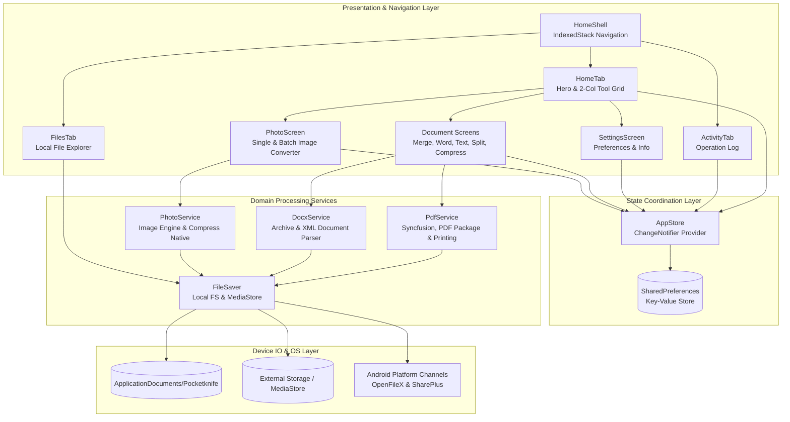

# POCKETKNIFE ARCHITECTURE SPECIFICATION

> **Document:** `docs/architecture/ARCHITECTURE.md`  
> **Audience:** Senior Engineers, Maintainers & AI Systems  
> **Status:** Current & Verified

---

## 1. System Overview

Pocketknife is an offline document and image processing application built on Flutter. Its primary mission is to provide instantaneous, zero-latency utilities without leaking user data to remote servers.

### Architectural Tenets
1. **Zero External Network Footprint:** The application makes 0 HTTP/Socket calls and declares no `INTERNET` permission in its Android manifest.
2. **Pure Local Computation:** All document transformations (DOCX to PDF, PDF merging/splitting, raster shrinking, and image encoding) take place in the device's CPU and memory.
3. **Reactive UI with Single-Source State:** Application state (persisted settings and activity log) is centrally coordinated via a single durable `AppStore` using Flutter's `ChangeNotifier` and `provider`.
4. **Predictable File Lifecycle:** Input files are read into transient memory buffers (`Uint8List`), transformed, and persisted to predictable local application storage before handoff to system viewers.

---

## 2. High-Level Component Topology

---

## 3. Layered Architecture Details

### 3.1 Presentation & UI Layer (`app/lib/screens/` and `app/lib/widgets/`)
- **Navigation Structure:** Controlled by `HomeShell`, hosting an `IndexedStack` of three root tabs:
  - `HomeTab`: Header with logo, title, and settings gear button; `HeroBanner` with 3D folder art; "All Tools" section header with "See All ->" navigation; and a 2-column grid of 6 tool cards.
  - `FilesTab`: A built-in local file explorer that lists, searches, opens, shares, and deletes processed files directly from `getApplicationDocumentsDirectory()/Pocketknife`.
  - `ActivityTab`: Operation history display showing human-readable file details, timestamps, and quick action sheets.
- **Design System Elements:**
  - `AppScaffold`: Standardized canvas wrapper with circular back button, title, subtitle, circular help dialog button (`?`), and sticky or floating bottom action bar.
  - `PrimaryButton`: 52px height vibrant royal blue (`#1D61F2`) action button with rounded corners (radius 14) and integrated progress indicator.
  - `SoftButton`: Pill-style light blue (`#EFF6FF`) secondary action button (e.g. "+ Add More PDFs").
  - `SegmentedTabs`: Pill-shaped segmented mode switcher (used in Image Converter for Single Image vs Batch Convert).
  - `FormatChips`: Custom rounded format selection chips with royal blue highlight border for active items.
  - `BrandLogo`: Custom-painted vector pocketknife blade with blue pivot rivet dot and dark navy background.

### 3.2 State Management (`app/lib/services/store.dart`)
- **`AppStore`**: Extends `ChangeNotifier`.
  - Manages `saveToGallery` (boolean preference).
  - Manages `activity` (ordered list of `ActivityItem` instances).
  - Persists data to `SharedPreferences` via JSON encoding.
  - Implements defensive decoding: automatically strips obsolete `downloadJob` keys from legacy versions and defaults missing values gracefully.

### 3.3 Domain & Computation Services (`app/lib/services/`)
- **`PdfService` (`pdf_service.dart`)**:
  - `merge(List<Uint8List>)`: Combines multiple PDF streams into one using Syncfusion PDF page duplication.
  - `extractPages(Uint8List, List<int>)`: Extracts selected 0-based page indices into a new document.
  - `compress(Uint8List, CompressStrength)`: Converts PDF pages to raster bitmaps via `Printing.raster()` at calibrated DPI/quality and re-encodes them into a compact PDF.
  - `textToPdf(String, {String title})`: Formats raw text across A4 pages with Inter font typography and page numbering.
  - `pageCount(Uint8List)`: Fast metadata extraction returning the total page count.
- **`DocxService` (`docx_service.dart`)**:
  - Reads `.docx` archives using `package:archive`.
  - Parses `word/document.xml` using `package:xml` to extract paragraphs, headings, bullet runs, and linebreaks.
  - Renders the resulting DOM into a paginated vector PDF via `package:pdf`.
- **`PhotoService` (`photo_service.dart`)**:
  - Resizes images with aspect ratio locking or exact dimension targeting using `package:image`.
  - Encodes across 5 target formats: JPG (lossy), PNG (lossless), WebP (lossy compression via `flutter_image_compress`), BMP, and GIF.
  - `probe(Uint8List)`: Decodes image headers to instantly extract width and height.
- **`FileSaver` (`file_saver.dart`)**:
  - Manages persistent writing to `getApplicationDocumentsDirectory()/Pocketknife`.
  - Manages optional copy to Android public folders (`Pictures/Pocketknife` or `Download/Pocketknife`) via `saver_gallery`.
  - Launches system viewers using `open_filex` and share dialogs via `share_plus`.
  - Enumerates and deletes stored output files for the `FilesTab`.

---

## 4. Key Architectural Decisions (ADRs)

### ADR 1: Complete Removal of Network Downloaders
- **Context:** The original codebase included YouTube Explode, FFmpegKit, Dio, and HTTP for downloading video and audio.
- **Decision:** Excise these dependencies completely to make Pocketknife a dedicated, lightweight, 100% offline file utility.
- **Consequence:** Drastically reduced APK size, eliminated heavy native binaries (FFmpeg C++ libraries), removed network permissions (`INTERNET`, `ACCESS_NETWORK_STATE`), and eliminated background network failure states.

### ADR 2: Hybrid In-Memory and Application Storage
- **Context:** Mobile OS permissions for shared public storage (MediaStore / Scoped Storage) vary widely across Android 9 to 14+.
- **Decision:** Every processed file is immediately saved to durable app-private storage (`getApplicationDocumentsDirectory()/Pocketknife`) where Android permissions are never required. Secondary public gallery/download saving is attempted opportunistically without blocking the user.
- **Consequence:** 100% reliability for opening and sharing files regardless of Android OS version or OEM permission quirks.

### ADR 3: Pure Dart Word-to-PDF Conversion
- **Context:** Standard DOCX conversion typically requires a headless LibreOffice or cloud API.
- **Decision:** Implement an in-memory XML unzipper and paragraph mapper that translates OOXML runs into Flutter `pdf` package widgets.
- **Consequence:** Zero server requirements, instant conversion, complete privacy, with a known limitation that advanced Word features (complex nested tables or shape art) are simplified to text flow.
