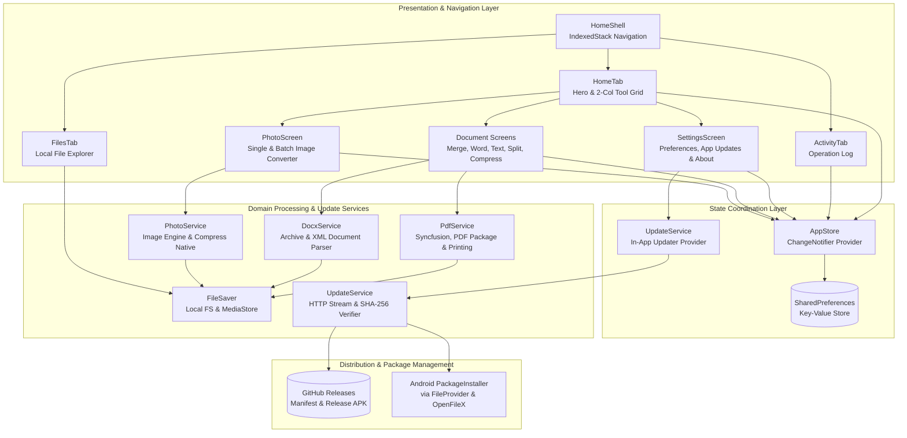

# POCKETKNIFE ARCHITECTURE SPECIFICATION

> **Document:** `docs/architecture/ARCHITECTURE.md`  
> **Audience:** Senior Engineers, Maintainers & AI Systems  
> **Status:** Current & Verified | **Distribution:** GitHub Releases In-App Updater

---

## 1. System Overview

Pocketknife is an offline document and image processing application built on Flutter, with an integrated, user-controlled in-app update delivery mechanism powered by GitHub Releases.

### Architectural Tenets
1. **Isolated Scoped Networking:** All document and media processing operations are 100% offline. Network connectivity (`INTERNET`) is strictly scoped to fetching update manifests and downloading official update APKs from trusted GitHub endpoints.
2. **Pure Local Computation:** All document transformations (DOCX to PDF, PDF merging/splitting, raster shrinking, and image encoding) take place entirely in the device's CPU and memory.
3. **Reactive UI with Multi-Provider State:** Application state is centrally coordinated via `AppStore` (preferences, activity log) and `UpdateService` (manifest querying, progress streaming, and installation state) using Flutter's `ChangeNotifier` and `provider`.
4. **Predictable File Lifecycle:** Input files are read into transient memory buffers (`Uint8List`), transformed, and persisted to predictable local application storage before handoff to system viewers.

---

## 2. High-Level Component Topology

---

## 3. Layered Architecture Details

### 3.1 Presentation & UI Layer (`app/lib/screens/` and `app/lib/widgets/`)
- **Navigation Structure:** Controlled by `HomeShell`, hosting an `IndexedStack` of three root tabs:
  - `HomeTab`: Header with logo, title, and settings gear button; `HeroBanner` with 3D folder art; "All Tools" section header with "See All ->" navigation; and a 2-column grid of 6 tool cards.
  - `FilesTab`: A built-in local file explorer that lists, searches, opens, shares, and deletes processed files directly from `getApplicationDocumentsDirectory()/Pocketknife`.
  - `ActivityTab`: Operation history display showing human-readable file details, timestamps, and quick action sheets.
- **Settings Screen (`settings_screen.dart`):** Contains the **App Updates** card:
  - Displays installed version and build number via `package_info_plus`.
  - Manual "Check for Updates" trigger with non-intrusive in-place card states.
  - Formatted release notes display for available updates.
  - Live download progress indicator (`percentage`, `downloaded / total bytes`).
  - Checksum validation status and "Install Update" action.

### 3.2 State Management (`app/lib/services/`)
- **`AppStore` (`store.dart`)**:
  - Manages `saveToGallery` and `activity` list (`ActivityItem`).
  - Persists data to `SharedPreferences` via JSON encoding.
- **`UpdateService` (`update_service.dart`)**:
  - Extends `ChangeNotifier` and coordinates the update lifecycle.
  - States: `idle`, `checking`, `upToDate`, `updateAvailable`, `downloading`, `readyToInstall`, `installing`, `error`.
  - Compares `AppVersion` using semantic version rules and version codes.
  - Streams APK downloads over HTTPS with manual redirect validation.
  - Computes running SHA-256 hash using `package:crypto`.
  - Manages `REQUEST_INSTALL_PACKAGES` permission and invokes Android's package installer.

### 3.3 Domain & Computation Services (`app/lib/services/`)
- **`PdfService` (`pdf_service.dart`)**:
  - Pure-Dart and Syncfusion PDF operations: merging, page extraction, page count extraction, text-to-PDF formatting, and raster-based compression.
- **`DocxService` (`docx_service.dart`)**:
  - Pure-Dart unzipping of `.docx` archives, XML DOM extraction of paragraphs, headings, and runs, rendered to PDF.
- **`PhotoService` (`photo_service.dart`)**:
  - Multi-format image engine supporting JPG, PNG, WebP, BMP, and GIF with quality and aspect-ratio-locked resizing.
- **`FileSaver` (`file_saver.dart`)**:
  - Manages disk persistence to `getApplicationDocumentsDirectory()/Pocketknife` and opportunistic gallery/download saving.

---

## 4. Key Architectural Decisions (ADRs)

### ADR 1: Complete Removal of Media Downloaders
- **Context:** The legacy app bundled YouTube Explode, FFmpegKit, Dio, and HTTP for downloading video/audio streams.
- **Decision:** Excise these dependencies completely to make Pocketknife a dedicated, lightweight file utility.
- **Consequence:** Dropped 10 heavy dependencies and massive C++ FFmpeg binaries, reduced APK size from ~85MB to ~20MB, and eliminated network failure states.

### ADR 2: Hybrid In-Memory and Application Storage
- **Context:** Mobile OS permissions for shared public storage vary across Android versions.
- **Decision:** Every processed file is immediately written to app-private storage (`getApplicationDocumentsDirectory()/Pocketknife`), where Android permissions are never required.
- **Consequence:** 100% reliable viewing and sharing regardless of Android OS version.

### ADR 3: Pure Dart Word-to-PDF Conversion
- **Context:** Standard DOCX conversion typically requires a headless LibreOffice server or cloud API.
- **Decision:** Implement an in-memory XML unzipper and paragraph mapper that translates OOXML runs into Flutter `pdf` package widgets.
- **Consequence:** Zero server requirements, instant conversion, complete privacy.

### ADR 4: GitHub Releases-Based In-App Update Engine
- **Context:** Since Pocketknife is distributed outside the Google Play Store (direct APK download), users need an automated, friction-free way to discover, download, and install updates.
- **Decision:** Implement an in-app updater querying a static JSON manifest hosted on GitHub raw content (`app-update.json`) that points to official GitHub Releases.
- **Security & Reliability Controls:**
  - Enforce HTTPS for all manifest and download requests.
  - Whitelist download domains strictly to `github.com` and `githubusercontent.com`.
  - Support SHA-256 checksum verification before launching the package installer.
  - Never execute silent installs; hand off to Android's native `PackageInstaller` via `FileProvider`.
