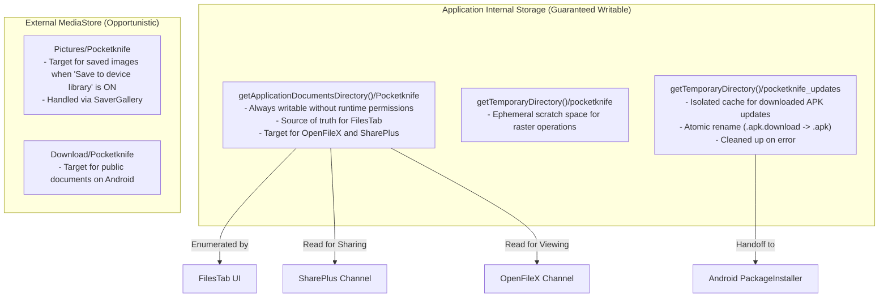

# POCKETKNIFE — DATA STORAGE & NETWORKING SPECIFICATION

> **Document:** `docs/architecture/DATA_STORAGE_AND_NETWORKING.md`  
> **Status:** Current & Verified | **Network Model:** Scoped strictly to In-App Updates

---

## 1. Networking Policy & Privacy Architecture

Pocketknife maintains a strict separation of concerns between its offline utility engines and its in-app update delivery mechanism.

### 1.1 Offline Engine Isolation
- All PDF manipulation, Word-to-PDF parsing, text rendering, and image conversion algorithms execute 100% locally on the device processor and storage.
- User documents, photos, text notes, and file metadata are **never** transmitted over any network socket.

### 1.2 Scoped In-App Update Networking
Network connectivity is strictly constrained to the `UpdateService`:
1. **Manifest Checks:** Fetching `https://raw.githubusercontent.com/shadowmodex/pocketknife/master/app-update.json` via HTTPS.
2. **APK Downloads:** Downloading official release artifacts from verified GitHub endpoints (`github.com`, `objects.githubusercontent.com`).

### 1.3 Manifest Permissions Audit
The `AndroidManifest.xml` (`app/android/app/src/main/AndroidManifest.xml`) contains the following verified permissions:

```xml
<uses-permission android:name="android.permission.WRITE_EXTERNAL_STORAGE" android:maxSdkVersion="28"/>
<uses-permission android:name="android.permission.READ_EXTERNAL_STORAGE" android:maxSdkVersion="32"/>
<uses-permission android:name="android.permission.READ_MEDIA_IMAGES"/>

<!-- Required for checking and downloading in-app updates from GitHub Releases -->
<uses-permission android:name="android.permission.INTERNET"/>
<!-- Required on Android 8+ for opening package installer when user approves update -->
<uses-permission android:name="android.permission.REQUEST_INSTALL_PACKAGES"/>
```

| Permission | Status | Justification / Role |
|---|---|---|
| `android.permission.INTERNET` | **Scoped (Update Only)** | Required exclusively to query GitHub raw manifest and stream APK updates. |
| `android.permission.REQUEST_INSTALL_PACKAGES` | **Active (Android 8+)** | Required so Android's native `PackageInstaller` can be invoked after an APK is downloaded and verified. |
| `android.permission.ACCESS_NETWORK_STATE` | **REMOVED** | Not needed. The app does not track background network changes. |
| `android.permission.READ_MEDIA_VIDEO` | **REMOVED** | Excised. Video downloader is completely removed. |
| `android.permission.READ_MEDIA_AUDIO` | **REMOVED** | Excised. Audio downloader is completely removed. |
| `WRITE_EXTERNAL_STORAGE` | **Retained (maxSdk 28)** | Required for Android 9 and lower for saving to public Pictures/Downloads. |
| `READ_EXTERNAL_STORAGE` | **Retained (maxSdk 32)** | Required for picking documents/images on Android 12 and lower. |
| `READ_MEDIA_IMAGES` | **Retained** | Required on Android 13+ for picking photos in the Image Converter. |

---

## 2. File Storage Architecture



### 2.1 File Storage Locations
1. **Primary Durable App Storage:**
   - Path: `Directory('${base.path}/Pocketknife')` where `base` is `getApplicationDocumentsDirectory()`.
   - Guaranteed writable without runtime storage permissions on all Android versions.
   - Files are enumerated by `FileSaver.instance.listSavedFiles()` to populate the `FilesTab`.
2. **Temporary Processing Directory:**
   - Path: `Directory('${base.path}/pocketknife')` where `base` is `getTemporaryDirectory()`.
   - Used for intermediate raster bitmaps during PDF compression and DOCX extraction.
3. **In-App Updates Cache:**
   - Path: `Directory('${base.path}/pocketknife_updates')` where `base` is `getTemporaryDirectory()`.
   - Incoming downloads stream to `.apk.download` while SHA-256 hash is computed on the fly.
   - Renamed atomically to `PocketKnife_<version>.apk` once checksum and file size are verified.
   - Failed or aborted downloads are immediately purged.
4. **Public Gallery / Downloads (MediaStore):**
   - Managed by `saver_gallery`.
   - Images are saved to `Pictures/Pocketknife`.
   - Documents are saved to `Download/Pocketknife`.

---

## 3. Persistent State & Preferences Schema

Pocketknife stores non-file state inside Android's `SharedPreferences` via the `shared_preferences` plugin.

### Keys & Types:
| Key | Type | Description | Default |
|---|---|---|---|
| `pk_save_to_gallery` | `bool` | Whether converted images are automatically copied to public Pictures | `true` |
| `pk_activity` | `List<String>` | JSON-encoded array of `ActivityItem` records (max 200 items) | `[]` |

---

## 4. File Management & Maintenance (`FilesTab`)

The `FilesTab` acts as a complete file manager for the app's output directory:
- **Listing:** Reads directory asynchronously and sorts files by `lastModifiedSync()` descending.
- **Search:** Real-time client-side substring filter on file names.
- **Open Action:** Invokes `OpenFilex.open(file.path)` to trigger Android's native `Intent.ACTION_VIEW` with `FileProvider` URI.
- **Share Action:** Invokes `Share.shareXFiles([XFile(file.path)])` to trigger the Android system share sheet.
- **Delete Action:** Shows a confirmation dialog, deletes file from disk via `file.delete()`, and refreshes the list.
