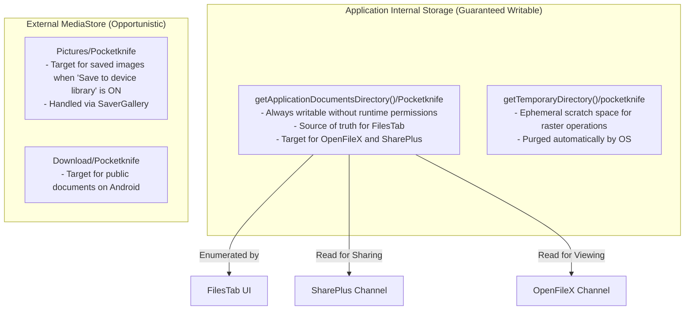

# POCKETKNIFE — DATA STORAGE & NETWORKING SPECIFICATION

> **Document:** `docs/architecture/DATA_STORAGE_AND_NETWORKING.md`  
> **Status:** Current & Verified | **Network Model:** 100% Offline

---

## 1. Zero-Network Policy & Privacy Architecture

Pocketknife enforces an absolute zero-network architectural boundary.

### 1.1 Manifest Permissions Audit
The `AndroidManifest.xml` (`app/android/app/src/main/AndroidManifest.xml`) contains **NO** network permissions.

```xml
<!-- Active Storage Permissions -->
<uses-permission android:name="android.permission.WRITE_EXTERNAL_STORAGE" android:maxSdkVersion="28" />
<uses-permission android:name="android.permission.READ_EXTERNAL_STORAGE" android:maxSdkVersion="32" />
<uses-permission android:name="android.permission.READ_MEDIA_IMAGES" />
```

| Permission | Status | Justification / Role |
|---|---|---|
| `android.permission.INTERNET` | **REMOVED** | Excised during downloader removal. App cannot open sockets or HTTP connections. |
| `android.permission.ACCESS_NETWORK_STATE` | **REMOVED** | Excised. App has no concept of connectivity or network status. |
| `android.permission.READ_MEDIA_VIDEO` | **REMOVED** | Excised. Video downloader is completely removed. |
| `android.permission.READ_MEDIA_AUDIO` | **REMOVED** | Excised. Audio downloader is completely removed. |
| `WRITE_EXTERNAL_STORAGE` | **Retained (maxSdk 28)** | Required for Android 9 and lower for saving to public Pictures/Downloads. |
| `READ_EXTERNAL_STORAGE` | **Retained (maxSdk 32)** | Required for picking documents/images on Android 12 and lower. |
| `READ_MEDIA_IMAGES` | **Retained** | Required on Android 13+ for picking photos in the Image Converter. |

---

## 2. File Storage Architecture



### 2.1 File Storage Locations
1. **Primary Durable App Storage:**
   - Path: `Directory('${base.path}/Pocketknife')` where `base` is `getApplicationDocumentsDirectory()`.
   - Guaranteed writable without runtime storage permissions on all Android versions.
   - Files are enumerated by `FileSaver.instance.listSavedFiles()` to populate the `FilesTab`.
2. **Temporary Processing Directory:**
   - Path: `Directory('${base.path}/pocketknife')` where `base` is `getTemporaryDirectory()`.
   - Used for intermediate raster bitmaps during PDF compression and DOCX extraction.
3. **Public Gallery / Downloads (MediaStore):**
   - Managed by `saver_gallery`.
   - Images are saved to `Pictures/Pocketknife`.
   - Documents are saved to `Download/Pocketknife`.

---

## 3. Persistent State & Preferences Schema

Pocketknife stores non-file state inside Android's `SharedPreferences` via the `shared_preferences` plugin.

### Keys & Types:
| Key | Type | Description | Default |
|---|---|---|---|
| `pk_save_to_gallery` | `bool` | Whether converted images are automatically copied to public Pictures | `true` |
| `pk_activity` | `List<String>` | JSON-encoded array of `ActivityItem` records (max 200 items) | `[]` |

### `ActivityItem` JSON Schema:
```json
{
  "id": "1730164800000",
  "kind": "mergePdf",
  "name": "Merged_Document.pdf",
  "meta": "Merged 4 PDFs • 8.4 MB",
  "savedPath": "/data/user/0/com.irshad.pocketknife/app_flutter/Pocketknife/Merged_Document.pdf",
  "at": 1730164800000
}
```

> [!NOTE]
> When upgrading from legacy versions, `AppStore` automatically ignores obsolete downloader fields (`pk_video_quality`, `pk_mp3_bitrate`, `pk_jobs`) without crashing or losing user activity logs.

---

## 4. File Management & Maintenance (`FilesTab`)

The `FilesTab` acts as a complete file manager for the app's output directory:
- **Listing:** Reads directory asynchronously and sorts files by `lastModifiedSync()` descending.
- **Search:** Real-time client-side substring filter on file names.
- **Open Action:** Invokes `OpenFilex.open(file.path)` to trigger Android's native `Intent.ACTION_VIEW` with `FileProvider` URI.
- **Share Action:** Invokes `Share.shareXFiles([XFile(file.path)])` to trigger the Android system share sheet.
- **Delete Action:** Shows a confirmation dialog, deletes file from disk via `file.delete()`, and refreshes the list.
