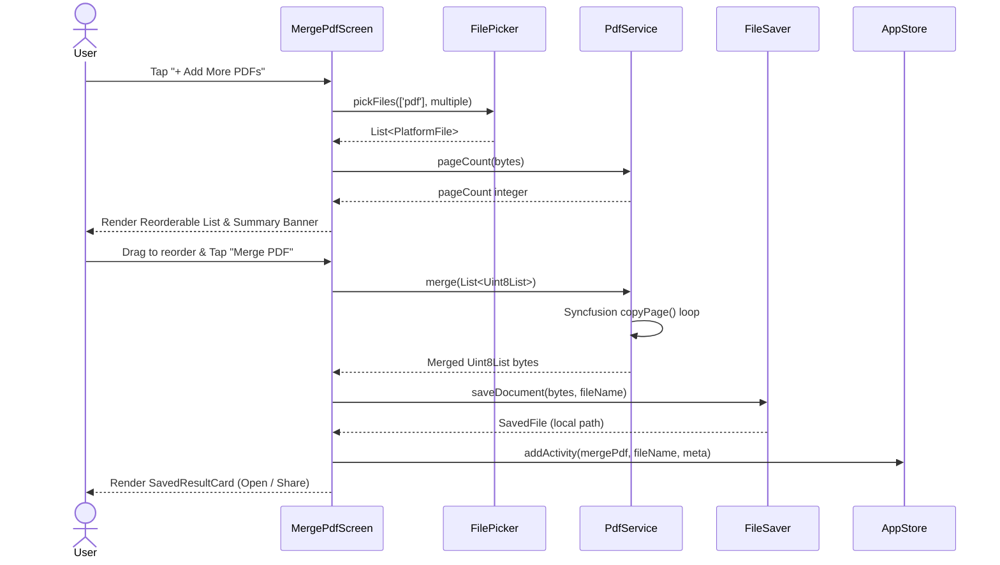
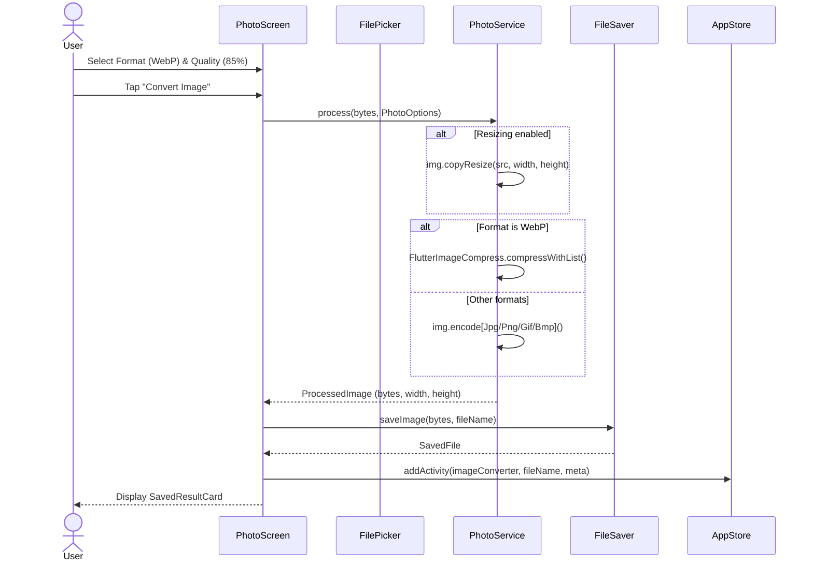

# POCKETKNIFE — DETAILED FEATURE EXECUTION FLOWS

> **Document:** `docs/architecture/FEATURES.md`  
> **Status:** Verified from Codebase | **Tool Count:** 6 Active Offline Tools

---

## 1. Merge PDF

### 1.1 Overview & Entry Point
- **Screen:** [`MergePdfScreen`](file:///d:/Pocketknife/app/lib/screens/docs/merge_pdf_screen.dart)
- **Tool Identifier:** `ToolKind.mergePdf`
- **Purpose:** Allows selecting 2 or more PDF files, visually reordering them via drag-and-drop, inspecting page counts and sizes, and combining them into a single output PDF with custom naming.

### 1.2 Execution Order & Call Trace
1. **User Action (Pick Files):** User taps `PickTile` or `+ Add More PDFs` (`SoftButton`).
2. **File Selection:** Invokes `FilePicker.platform.pickFiles(type: FileType.custom, allowedExtensions: ['pdf'], allowMultiple: true)`.
3. **Metadata Analysis:** For each picked file, `PdfService.instance.pageCount(bytes)` parses the PDF header via `sf.PdfDocument(inputBytes: bytes).pages.count` to extract page counts.
4. **Reordering:** Handled by `ReorderableListView.builder` using `onReorderItem: (oldIndex, newIndex)` to update the in-memory `_files` list.
5. **Execution (Merge):** User taps `PrimaryButton` ("Merge PDF").
6. **Core Processing:** `PdfService.instance.merge([bytes1, bytes2, ...])` creates a new `sf.PdfDocument()`, copies each page losslessly as a template, and outputs `Uint8List`.
7. **Storage:** `FileSaver.instance.saveDocument(bytes, fileName)` writes bytes to `ApplicationDocuments/Pocketknife/` and registers with MediaStore if accessible.
8. **Logging:** `AppStore.addActivity(...)` adds entry with human-readable summary.
9. **UI Feedback:** Displays `SavedResultCard` with direct "Open" and "Share" options.

### 1.3 Sequence Diagram

---

## 2. Image Converter / Resizer

### 2.1 Overview & Entry Point
- **Screen:** [`PhotoScreen`](file:///d:/Pocketknife/app/lib/screens/photo_screen.dart)
- **Tool Identifier:** `ToolKind.imageConverter`
- **Purpose:** Converts single or batch images across JPG, PNG, WebP, JPEG, and GIF formats with adjustable quality slider and optional linked aspect-ratio resizing.

### 2.2 Execution Order & Call Trace
1. **Mode Switch:** Controlled by `SegmentedTabs` ("Single Image" vs "Batch Convert").
2. **File Selection:** Invokes `FilePicker.platform.pickFiles(type: FileType.image)`.
3. **Header Probing:** `PhotoService.instance.probe(bytes)` reads metadata returning width and height.
4. **Parameter Tuning:**
   - Format: `FormatChips` selects between `JPG`, `PNG`, `WebP`, `JPEG`, and `GIF`.
   - Quality: `Slider` controls compression level (10% to 100%).
   - Resize: Optional toggle activates Width and Height inputs. When "Keep aspect ratio" is checked, editing width automatically computes proportional height and vice versa.
5. **Core Processing:** `PhotoService.instance.process(inputBytes, options)`:
   - Resizes bitmap using `img.copyResize()` if dimensions requested.
   - For JPG: uses `img.encodeJpg(im, quality: q)`.
   - For PNG: uses `img.encodePng(im)`.
   - For BMP: uses `img.encodeBmp(im)`.
   - For GIF: uses `img.encodeGif(im)`.
   - For WebP: pipes lossless raw PNG bytes through `FlutterImageCompress.compressWithList(..., format: CompressFormat.webp)` for accelerated native WebP encoding.
6. **Storage:** `FileSaver.instance.saveImage(out.bytes, fileName)` writes to local disk and triggers gallery save if enabled in settings.

### 2.3 Sequence Diagram

---

## 3. Word to PDF

### 3.1 Overview & Entry Point
- **Screen:** [`WordToPdfScreen`](file:///d:/Pocketknife/app/lib/screens/docs/word_to_pdf_screen.dart)
- **Tool Identifier:** `ToolKind.wordToPdf`
- **Purpose:** Converts Microsoft Word `.docx` documents into vector PDFs offline.

### 3.2 Execution Order & Call Trace
1. **File Selection:** User picks `.docx` file using `FilePicker`.
2. **Execution:** User taps "Convert to PDF".
3. **Core Processing:** `DocxService.instance.docxToPdf(bytes, title)`:
   - Unzips archive using `ZipDecoder().decodeBytes(bytes)`.
   - Reads `word/document.xml`.
   - Traverses `<w:p>` paragraph nodes and parses run formatting:
     - Detects heading styles (`Heading1`, `Heading2`).
     - Detects bold runs (`<w:b>`) and italic runs (`<w:i>`).
     - Detects bullet points (`<w:numPr>`).
   - Renders paragraphs into `pw.Document` using `package:pdf` with standard A4 margins and Inter typography.
4. **Storage:** Saved via `FileSaver.instance.saveDocument()`.

---

## 4. Text to PDF

### 4.1 Overview & Entry Point
- **Screen:** [`TextToPdfScreen`](file:///d:/Pocketknife/app/lib/screens/docs/text_to_pdf_screen.dart)
- **Tool Identifier:** `ToolKind.textToPdf`
- **Purpose:** Takes typed or pasted notes and formats them into an A4 PDF with automatic pagination and page numbering.

### 4.2 Execution Order & Call Trace
1. **Input:** User provides optional Title and multiline Body text.
2. **Execution:** User taps "Create PDF".
3. **Core Processing:** `PdfService.instance.textToPdf(body, title)`:
   - Loads Inter font asset (`assets/fonts/Inter.ttf`) if available.
   - Splits text by newline and maps each paragraph into `pw.MultiPage`.
   - Adds footer with `${ctx.pageNumber} / ${ctx.pagesCount}` on each page.
4. **Storage:** Saved via `FileSaver.instance.saveDocument()`.

---

## 5. Split / Extract PDF

### 5.1 Overview & Entry Point
- **Screen:** [`SplitPdfScreen`](file:///d:/Pocketknife/app/lib/screens/docs/split_pdf_screen.dart)
- **Tool Identifier:** `ToolKind.splitPdf`
- **Purpose:** Extracts specific pages or page ranges (e.g., `1-3, 5`) from a PDF into a new PDF document.

### 5.2 Execution Order & Call Trace
1. **Input:** User picks a PDF; page count is extracted.
2. **Range Specification:** User enters ranges in text field. `parseRanges(text, totalPages)` in `util.dart` validates and converts tokens into ordered, de-duplicated 0-based indices.
3. **Core Processing:** `PdfService.instance.extractPages(input, pages)`:
   - Uses Syncfusion to create destination `sf.PdfDocument`.
   - Iterates through requested page indices, drawing each page template onto the target document.
4. **Storage:** Saved via `FileSaver.instance.saveDocument()`.

---

## 6. Compress PDF

### 6.1 Overview & Entry Point
- **Screen:** [`CompressPdfScreen`](file:///d:/Pocketknife/app/lib/screens/docs/compress_pdf_screen.dart)
- **Tool Identifier:** `ToolKind.compressPdf`
- **Purpose:** Reduces the file size of heavy or scanned PDFs using calibrated raster-based downsampling.

### 6.2 Execution Order & Call Trace
1. **Input & Level Selection:** User picks PDF and selects compression strength:
   - **Light:** 150 DPI, JPEG Quality 80 (Best visual fidelity).
   - **Balanced (Recommended):** 120 DPI, JPEG Quality 60 (Optimal size/clarity balance).
   - **Strong:** 96 DPI, JPEG Quality 45 (Smallest file size).
2. **Core Processing:** `PdfService.instance.compress(input, strength)`:
   - Streams pages through `Printing.raster(input, dpi: strength._dpi)`.
   - Re-encodes rendered frames as JPEG images using `img.encodeJpg(..., quality: strength._quality)`.
   - Rebuilds PDF document embedding the compressed image pages.
3. **Storage:** Saved via `FileSaver.instance.saveDocument()`.
4. **UI Feedback:** Displays percentage reduction (e.g., "42% smaller").
